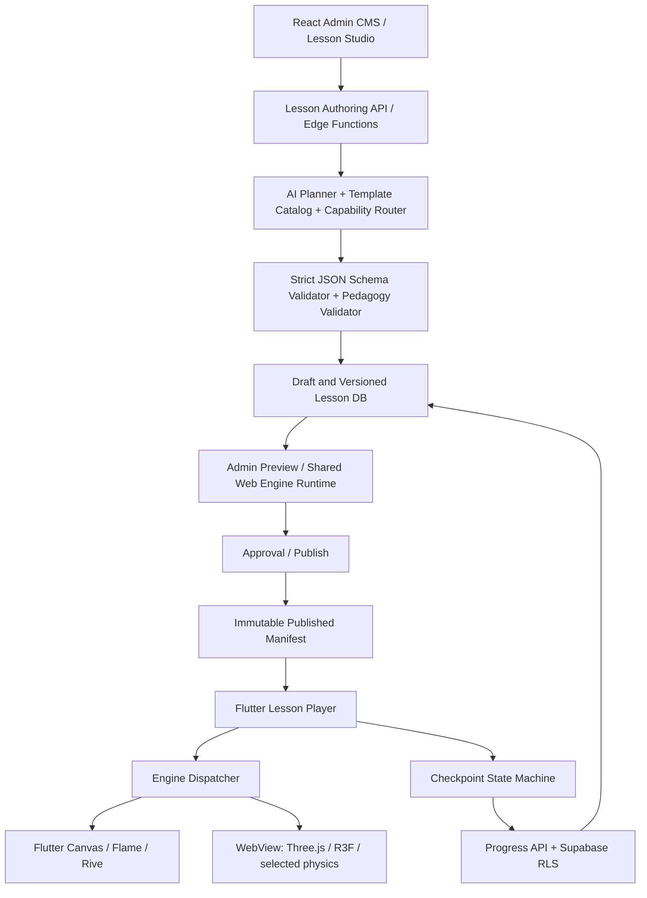

# MASTER SPEC — Brilliant-inspired Interactive Learning Platform (Grade 6–9)

> Version: 1.0 · 2026-11-12 · Language: Vietnamese · Status: IMPLEMENTATION BLUEPRINT, NOT IMPLEMENTED CODE
>
> Target: React Admin CMS + Smart Lesson Studio + Supabase + Flutter Mobile Player + persistent interactive 2D/3D lesson scenes.
>
> **Integration note:** The existing repository / `rea` skill folder is **not mounted in this session**. This document specifies how the coding agent should locate, read, and extend that skill **in the actual repository**, without overwriting existing instructions. Nothing below claims the existing repo, Supabase, or mobile app has already been edited.

---

## 0. Mission, guardrails and acceptance

Build a learning product inspired by the **learning-by-doing patterns** of Brilliant.org, not a pixel-for-pixel copy, and do not copy proprietary artwork, screenshots, source, trademarks, lesson text or paid course content. Use an original design system, original illustrations and original curriculum-aligned lesson material. Reference: https://brilliant.org/faq/ .

**Non-negotiable learning model:** `1 lesson = 1 persistent scene/canvas + N progressive checkpoints`. A checkpoint changes instruction, constraints, targets, permitted actions, feedback and optional camera transitions; it MUST NOT remount the entire engine/canvas by default. A scene may transition deliberately between chapters, but must preserve explicit state and support continuity. Primary interaction must be manipulating an object, measuring, constructing, sorting, animating, experimenting or exploring; ordinary multiple-choice must never become the default fallback.

Prioritize **Mathematics grades 6–9**. Design schema extensible to other subjects, but do not claim full curriculum coverage until supported by templates, validation and tests. Vietnamese first, localization-ready. Mobile phone portrait-first, tablet support, safe areas, touch targets, accessibility. Web admin desktop-first and tablet usable.

### Definition of Done (DoD)
1. Admin can create, edit, preview, validate, publish, unpublish, version and assign a multi-checkpoint lesson; changes survive reload.
2. Flutter loads a **published version** from Supabase, chooses a supported engine, renders a scene, handles actual gestures, advances checkpoint after an authoritative evaluated condition, persists and restores progress.
3. Admin preview and Flutter player share identical contract and checkpoint semantics; example fixture passes contract tests in both TypeScript and Dart.
4. At least one fully working vertical slice covers real 2D interaction and one real 3D interaction (not screenshots, static cards or button-only mockups).
5. No client-side service-role key, no unsafe arbitrary JS in JSON, robust RLS and scoped admin permissions, graceful loading/error states.
6. Automated tests, device smoke tests, browser console/network inspections and visual checks documented; failures reported truthfully.

---

## 1. Start by auditing existing repository and the `rea` skill

Do not scaffold a parallel project without examining the current repo. From repository root:

```bash
pwd
find . -maxdepth 4 \( -iname '*rea*' -o -name 'SKILL.md' -o -name 'GEMINI.md' -o -name 'AGENTS.md' \) -print
find . -maxdepth 3 \( -name 'package.json' -o -name 'pubspec.yaml' -o -name 'supabase' \) -print
find . -maxdepth 3 -type f | head -100
```

1. Open `rea`'s `SKILL.md` / its actual entrypoint and all referenced mandatory files. Identify original scope, triggers, safety constraints, conventions and dependent tools.
2. Extend the existing skill with a **new separate lesson-platform workflow** or referenced spec; **preserve original sections** and compatibility. Do not replace an unrelated skill with this spec. If `rea` is not intended for app engineering, add a sister skill and link to it instead.
3. Read project configs, routes, migrations, env examples, current schema, auth guards, Flutter player, lesson format, design tokens, tests and build scripts. Record what already exists, what is broken, what may be reused and what requires migration.
4. Inspect Supabase project identity and local configuration before connecting. Never print secret values. Back up schema and existing data before destructive migration. Never wipe production data for convenience.
5. Write `docs/architecture/audit.md` containing a factual inventory and gap checklist. Only then implement.

Suggested files to add **after discovering the real paths**:

```text
<repo>/
  docs/architecture/BRILLIANT_INTERACTIVE_LEARNING_MASTER_SPEC.md
  docs/architecture/audit.md
  docs/architecture/engine-capability-matrix.md
  docs/architecture/schema-migrations.md
  docs/qa/verification-report.md
  contracts/lesson.schema.json
  contracts/fixtures/grade7-triangle-angles.lesson.json
  contracts/fixtures/grade8-solid-volume.lesson.json
  .agent/skills/<existing-rea-skill>/references/lesson-platform.md  # ONLY if compatible with real skill layout
  GEMINI.md                                               # append a short routing rule, never replace
```

**Skill amendment example** (merge into correct existing format; not blindly append invalid frontmatter):

```markdown
## Interactive Lesson Platform workflow
When task involves React lesson CMS, Flutter lesson player, checkpoint, scene, engine selection or Supabase lesson data:
1. Read `docs/architecture/BRILLIANT_INTERACTIVE_LEARNING_MASTER_SPEC.md`.
2. Audit existing code and migrations before making changes.
3. Contract-first: validate `contracts/lesson.schema.json` and shared fixtures.
4. Keep a single live scene across checkpoints; preserve native gestures.
5. Run TS + Dart contract, integration, RLS and visual tests.
6. Publish only when DoD is satisfied; report blocked tasks and evidence.
```

---

## 2. Architecture (one data contract, multiple clients)



Use a **shared lesson domain contract**, not a shared UI runtime. UI frameworks stay native to their platforms. Schema values use stable engine capabilities and interaction types; an engine name alone does not guarantee feature compatibility. The mobile client advertises supported schema version, renderer version and capability IDs. Publishing must fail if required capabilities lack a supported mobile renderer.

Suggested repo structure (adapt to actual structure):

```text
apps/admin-web/                 React CMS/Studio (existing project preferred)
apps/mobile/                    Flutter app (existing project preferred)
packages/lesson-contract/       canonical JSON Schema, fixtures, semantic validators
packages/lesson-runtime-web/    interactive preview / WebView runtime
packages/lesson-engine-2d/      2D scene, drag, geometry, plots, hit tests
packages/lesson-engine-3d/      Three.js scene, meshes, cameras, raycasting
packages/lesson-authoring/      templates, capability router, scene transformations
supabase/migrations/            additive idempotent SQL migrations
supabase/functions/             trusted APIs, AI orchestrator, publication workflows
docs/qa/                        test matrix, logs, screenshots, profiling
```

---

## 3. Recommended technology stack by module

| Module / feature | Primary technology | Optional / constraints | Why and output |
|---|---|---|---|
| Admin shell / routing | React + TypeScript + Vite + React Router | reuse existing framework/router | fast content management; role-protected routes |
| Admin design system | Tailwind CSS + shadcn/ui (Radix primitives) | adapt existing styling | responsive menus, form fields, dialogs, accessibility |
| Admin data cache | TanStack Query | existing state solution | fetch, mutation, retries, invalidation, optimistic UI |
| Admin local state | Zustand | only where editor needs it | selection, history, tool mode, overlays |
| Schema-first forms | React Hook Form + Zod | Ajv for JSON Schema | property panels, validated structured forms |
| Lesson graph editor | React Flow / @xyflow/react | use sparingly | checkpoint transitions, prerequisites, branches |
| 2D scene authoring | Konva + react-konva or PixiJS | choose one per use case | draggable nodes, coordinate grids, geometry editors |
| Data visualization | D3 scales/math + SVG / Canvas | Visx optional | graphs, plotting, transformations; direct gestures |
| Web 3D preview | Three.js + React Three Fiber + Drei | raw Three.js core runtime | meshes, camera controls, selection, geometry transforms |
| 2D physics | Matter.js or planck.js | only if needed | collisions, springs and constraints; deterministic reset |
| 3D physics | Rapier JS | optional, validate WebView | rigid body physics; avoid for plain geometry lessons |
| UI microinteractions | Motion (React) + CSS | Rive for asset-based state machines | feedback animations, menus, completion cues |
| Flutter app shell | Flutter + Dart + Material 3 custom theme | respect existing navigation | Android/iOS learning interface |
| Flutter routing | go_router | existing router acceptable | deep links, auth redirect, lesson routes |
| Flutter app state | Riverpod | Bloc if already established | async lesson state, sessions, progress |
| Flutter typed models | json_serializable + freezed | Dart JSON Schema validation layer | schema-safe manifest and checkpoint state |
| Flutter 2D native renderer | CustomPainter + GestureDetector / Listener | Flame for game-loop scenes | high-fidelity mathematical interaction |
| Flutter 2D game loop | Flame | only for animated/game-style lessons | collision, camera, interactive simulation |
| Native vector/stateful asset | Rive Flutter | `.riv` file must be supplied/generated | visual animation + state machine; not arbitrary geometry generator |
| 3D mobile execution | `webview_flutter` + bundled mobile-compatible Three.js runtime | evaluate native 3D later | one tested 3D semantics engine across web/mobile |
| Flutter–JS bridge | versioned JSON messages over JavaScript channel | strict origin/message validation | start/set checkpoint, user events, state sync |
| Backend database | Supabase PostgreSQL | existing project, additive migrations | relational content, progress, authoring history |
| Authentication | Supabase Auth | honor existing roles | admin/teacher/student sessions |
| Authorization | PostgreSQL RLS + secure Edge Functions | never trust UI role alone | data boundaries and secure publish actions |
| Storage | Supabase Storage | signed URLs / public published assets | versioned images, GLB, `.riv`, audio |
| Server-side AI orchestration | Supabase Edge Functions (Deno/TS) | Python service for heavy tooling | generation, structured output, routing, validation |
| LLM provider | configurable model provider | no browser-exposed key | pedagogy planning and typed draft generation |
| Embedding / retrieval | pgvector + curated curriculum KB | only when needed | curriculum-grounded concepts and template retrieval |
| Background jobs | durable queued worker / controlled orchestration | don't assume Edge Function can run long task | asset generation, multi-stage lesson builds |
| Unit/contract tests web | Vitest + Testing Library + Ajv | fast-check optional | pure math, scene and schema checks |
| Browser E2E | Playwright | screenshots at checkpoints | CMS create/edit/preview/publish verification |
| Mobile tests | flutter test + integration_test | device farm later | widget/flow/native and WebView checks |
| Security checks | Supabase CLI tests, policy tests, static analysis | OWASP practices | verify RLS, auth, admin actions |
| CI/CD | GitHub Actions or existing CI | no new provider required | contracts → builds → tests → deploy checks |
| Logging | Sentry / structured diagnostics | privacy-safe telemetry | crash, rendering, content validity metrics |

### Engine capability matrix

| Capability | Admin preview | Flutter runtime | Renderer choice |
|---|---|---|---|
| Drag point / shape / label | Canvas/Konva | CustomPainter | `geometry_2d` |
| Slider affects shape/function | D3/SVG/Canvas | CustomPainter | `math_plot_2d` |
| Draw construction / angle | Konva geometry | CustomPainter | `geometry_2d` |
| Animated simulation / collisions | Matter.js | Flame or embedded web | `physics_2d` (one validated implementation per lesson) |
| State-driven character animation | Rive | Rive | `rive_scene` (requires authored `.riv` asset) |
| Rotate cube / prism / solid | Three.js/R3F | Three.js via WebView | `geometry_3d_web` |
| 3D rigid-body interactions | Rapier + Three.js | WebView only after device tests | `physics_3d_web` optional |
| Numeric graph / function tracing | D3 / canvas | CustomPainter | `math_plot_2d` |
| Spatial coordinate transformations | Three.js | Three.js via WebView | `geometry_3d_web` |

**Do not treat** Flutter Impeller, flutter_gl or Rive as automatic drop-in replacements for Three.js. Impeller is a Flutter rendering backend, not a lesson-level scene/interaction engine. WebGL in Android System WebView / iOS WKWebView needs empirical device checks. Build a canvas fallback for unsupported devices, with an educationally equivalent alternative if 3D cannot run. No untested physics dependence in initial MVP.

---

## 4. UI / UX design reference (original Brilliant-inspired design)

### 4.1 Flutter learner experience

Screens: Welcome/onboarding → Login → Home (continue/paths) → Courses/Grades → Course overview → Lesson Player → Review/Progress → Profile/Settings.

**Visual language:** warm off-white surface, rich navy copy, restrained sky-blue/purple/teal accents, roomy cards, custom original geometric illustrations, round 16–24dp corners, minimal chrome, typography supporting Vietnamese, single clear CTA. Do not replicate exact Brilliant graphic assets or layout pixel values.

**Lesson Player screen:**

```text
┌────────────────────────────────────┐
│ ←   Hình học lớp 7       ♡   ⋯   │
│ ════════════──────── 3 / 6        │
│                                    │
│       PERSISTENT LIVE SCENE        │
│  ┌──────────────────────────────┐  │
│  │ draggable triangle          │  │
│  │ angle handles / guide arcs  │  │
│  │ touch → direct feedback     │  │
│  └──────────────────────────────┘  │
│                                    │
│  Kéo đỉnh A và quan sát ba góc.   │
│  [Hint]           [Reset view]     │
│                                    │
│  Feedback: ✓ quan hệ vẫn đúng      │
│  [Tiếp tục →] (only when unlocked)  │
└────────────────────────────────────┘
```

Canvas should have stable identity and retain object identifiers across steps; do not key it by checkpoint ID. Accessibility: 44–48dp touch targets, screen reader summaries for geometry, haptic/audio optional, keyboard controls for compatible scenarios, reduced motion setting, color-independent outcomes.

### 4.2 Admin web dashboard

Desktop layout: side navigation + topbar + responsive content. Navigation:

- `Overview`: KPI drafts, published lessons, active learners, completion, render failures.
- `Users`: search/filter, role assignment, profile/status, enrollment, audit log, privacy.
- `Curriculum`: grade 6–9 → topic → course → module → lesson, tagging, prerequisites.
- `Lessons`: table/grid, draft/published/archived, duplicate, preview, version history.
- `Smart Lesson Studio`: prompt wizard, scene editor, object tree, property inspector, checkpoints, simulation/test, publish.
- `Engines & Templates`: supported renderers, asset catalog, reusable interaction templates, compatibility and required capabilities.
- `Analytics`: per-checkpoint pass/attempt/drop-off, hint usage, loading failure, device support.
- `Settings`: user roles, model provider and limits, asset quotas, workflow approvals.

**Smart Lesson Studio workspace** (desktop): left side asset/template + scene hierarchy; middle real-time 2D/3D scene; right property inspector; bottom persistent checkpoint timeline and simulation controls; top toolbar for undo/redo, validate, responsive mobile preview and publish. Scene selection must synchronize with JSON model, and editing checkpoint should create a diff/patch, not a new unrelated scene.

Key routes (adjust to existing router):

```text
/admin
/admin/users
/admin/curriculum
/admin/lessons
/admin/lessons/new
/admin/lessons/:lessonId/edit
/admin/lessons/:lessonId/versions
/admin/lessons/:lessonId/preview
/admin/engines
/admin/templates
/admin/analytics
/admin/settings
```

### 4.3 Workflow for nontechnical authors

`Grade → Curriculum topic → Learning objective → Suggested lesson blueprint → Engine candidates → AI draft checkpoint plan → visual preview → Edit objects/checkpoints → Run validator → Mobile simulation → Publish`.

Every suggestion must explain **why** engine is chosen and what mobile capabilities it requires. Provide manual engine override with compatibility warnings. Any generated draft remains editable via forms, timelines and direct manipulation; raw JSON is an expert-only secondary tab.

---

## 5. Content model: one persistent canvas and multiple checkpoints

### 5.1 Principles

- All lessons have `scene` initialized **once**, `checkpointIds` and a versioned `runtime` contract.
- Each checkpoint describes `instruction`, `allowedInteractions`, `scenePatch`, `constraints`, `successCriteria`, `hints`, `feedback`, optional `cameraPatch` and `onSuccessPatch`.
- Scene objects have **stable IDs**. A patch changes only specified properties of existing objects, or adds/removes objects explicitly.
- Physical state `sceneState` is separate from authoring configuration. Keep learner state between checkpoints unless reset is explicit.
- Win conditions are **declarative AST**, never executable code from content. Trusted evaluator implements allowed operators and checks tolerances.
- All user event capture goes through renderer adapters; engine reports interaction state, not untrusted `checkpointCompleted=true`.
- A single lesson should have a primary renderer; optional sub-scenes/capabilities must be explicit and compatible. Avoid hot switching engine on ordinary checkpoint transitions.

### 5.2 Canonical lesson manifest example (abridged but usable fixture)

```json
{
  "schemaVersion": "1.0.0",
  "lessonId": "grade7-triangle-angle-sum",
  "version": 1,
  "status": "draft",
  "locale": "vi-VN",
  "title": "Khám phá tổng ba góc tam giác",
  "grade": 7,
  "subject": "math",
  "topicIds": ["geometry", "triangles"],
  "learningObjectives": ["Nhận biết tổng ba góc trong tam giác bằng 180 độ"],
  "engine": {
    "type": "geometry_2d",
    "minRuntimeVersion": "1.0.0",
    "requiredCapabilities": ["drag_vertex", "measure_angle", "show_geometry_annotation"]
  },
  "scene": {
    "sceneId": "triangle-lab",
    "coordinateSystem": "cartesian_2d",
    "viewport": {"width": 360, "height": 360},
    "objects": [
      {"id": "A", "kind": "point", "position": [140, 60], "draggable": true},
      {"id": "B", "kind": "point", "position": [55, 265], "draggable": true},
      {"id": "C", "kind": "point", "position": [300, 265], "draggable": true},
      {"id": "triangle", "kind": "polygon", "vertexIds": ["A", "B", "C"]}
    ],
    "initialState": {"angleLabelsVisible": false, "dragCount": 0}
  },
  "checkpoints": [
    {
      "id": "cp-1",
      "order": 1,
      "instruction": "Kéo một đỉnh của tam giác để thay đổi hình dạng.",
      "allowedInteractions": ["drag_vertex"],
      "scenePatch": {"setState": {"angleLabelsVisible": false}},
      "successCriteria": {"op": "gte", "path": "metrics.validVertexDragCount", "value": 1},
      "hints": ["Thử chạm và kéo đỉnh A."],
      "feedback": {"success": "Hình dạng tam giác đã thay đổi!"}
    },
    {
      "id": "cp-2",
      "order": 2,
      "instruction": "Bật số đo các góc và kéo đỉnh A thêm một lần.",
      "allowedInteractions": ["toggle_angle_labels", "drag_vertex"],
      "scenePatch": {"setState": {"angleLabelsVisible": true}},
      "successCriteria": {"op": "gte", "path": "metrics.validVertexDragCountSinceCheckpoint", "value": 1},
      "hints": ["Các cung tròn biểu diễn góc tại mỗi đỉnh."],
      "feedback": {"success": "Hãy quan sát tổng ba góc!"}
    },
    {
      "id": "cp-3",
      "order": 3,
      "instruction": "Dùng thao tác ghép các góc để tạo thành góc bẹt 180°.",
      "allowedInteractions": ["drag_angle_token"],
      "scenePatch": {"addObjects": [
        {"id": "angle-token-a", "kind": "angle_token", "sourceVertexId": "A"},
        {"id": "angle-token-b", "kind": "angle_token", "sourceVertexId": "B"},
        {"id": "angle-token-c", "kind": "angle_token", "sourceVertexId": "C"}
      ]},
      "successCriteria": {"op": "all", "conditions": [
        {"op": "eq", "path": "metrics.snappedAngleTokens", "value": 3},
        {"op": "approx", "path": "metrics.assembledAngleDegrees", "value": 180, "tolerance": 0.5}
      ]},
      "hints": ["Ghép lần lượt ba góc sát nhau."],
      "feedback": {"success": "Ba góc tạo thành một góc bẹt 180°!"}
    }
  ],
  "completion": {"requiredCheckpointIds": ["cp-1", "cp-2", "cp-3"]}
}
```

The fixture illustrates authoring structure, **not** a complete validated schema. Implement and freeze an exact JSON Schema Draft 2020-12 in `contracts/lesson.schema.json` supporting the declared fields and conditional `oneOf` by object kinds. Also implement semantic validation for object references, checkpoint ordering, criterion paths, capability requirements, scene patches and pedagogical correctness. `validVertexDragCount` must only increment after a hit-tested, geometry-valid user drag, not raw tap count. Prevent a triangle from becoming degenerate (near-zero area) through geometry constraints.

### 5.3 Declarative criterion AST

Allowed operators: `eq`, `neq`, `gt`, `gte`, `lt`, `lte`, `approx`, `within`, `all`, `any`, `not`, `distance_le`, `angle_approx`, `object_inside`, `intersects`, `connected`, `ordered`, `dragged`, `constructed`. Paths must be whitelisted and type-checked. Use typed numbers and geometric units (degrees/radians, world/viewport), canonical precision and epsilon strategy. Never `eval`, dynamic Function or user-provided scripts in JSON.

Success evaluator processes **trusted normalized scene metrics** derived by engine + authored constraints, producing `blocked | success | needs_retry`, with reasons. Server validates checkpoint completion requests for plausible progression and idempotency; do not trust arbitrary client progress payload. For high-stakes scoring, compute server-verifiable metrics rather than solely client claims.

### 5.4 Checkpoint transition state machine

```text
LOADING → READY → INTERACTING → CRITERIA_MET → FEEDBACK → ADVANCING → READY
                                    ↘ RETRY ↗
                      → PAUSED / ERROR / RESUME / COMPLETED
```

Transition phases:
1. Freeze or debounce gestures, persist checkpoint metrics and attempt ID.
2. Show feedback without unloading the scene.
3. Apply deterministic `onSuccessPatch` / next `scenePatch` and camera tween in transaction.
4. Reset checkpoint-local counters only, preserve intended global geometry state.
5. Update instruction and progress UI, expose next permitted gestures.
6. Persist snapshot with scene version; handle backgrounding/replay/offline retry idempotently.

**Never** assign a new React `key` or recreate Flutter `WebViewController` merely because checkpoint index changed.

---

## 6. Smart Lesson Builder: AI planner, engine router and authoring

### Inputs
`grade, topic, curriculumStandard, learnerPrerequisites, objective, difficulty, language, timeTarget, desiredInteraction, optionalReference, deviceCapabilities`.

### Safe generation pipeline

1. **Curriculum retrieval:** retrieve vetted standards, grade-aligned concepts and approved interaction templates; never assume LLM-created facts are correct.
2. **Pedagogical plan:** AI creates concept sequence, misconceptions, 4–8 checkpoints (configurable), what student manipulates, expected discovery, hints and success evidence.
3. **Engine selection:** capabilities-based router scores feasible engines by expressivity, mobile support, interaction naturalness, device performance and implementation coverage; return primary + fallback and reasons.
4. **Scene synthesis:** choose a supported template and instantiate schema objects / patches; restrict to allowlisted assets and actions. For novel mechanics, request a developer-approved engine plugin rather than pretending arbitrary JSON can generate any mechanic.
5. **Validation:** JSON Schema + semantic graph validation + geometric constraints + curriculum review + mobile compatibility + content moderation and asset checks.
6. **Preview:** run checkpoint simulation with automated scripted gestures and an interactive admin preview; visually inspect at portrait device sizes.
7. **Human review:** admin edits, approves and publishes a new immutable version.

Engine-routing examples:

| Lesson intent | Primary engine | Interaction example | Why |
|---|---|---|---|
| Grade 6 fractions | `geometry_2d` | split/drag segments into a fraction bar | direct area/part-whole manipulation |
| Grade 6 integers | `math_plot_2d` | drag position on number line | motion and sign visualization |
| Grade 7 triangle angles | `geometry_2d` | drag vertices + compose angle tokens | geometry discovery |
| Grade 7 proportionality | `math_plot_2d` | adjust ratio slider, live graph updates | causal relationship |
| Grade 8 geometric solids | `geometry_3d_web` | rotate prism, toggle faces, fill layers | spatial reasoning |
| Grade 8 linear equations | `geometry_2d` | balance-scale drag equal weights | physical algebra metaphor |
| Grade 9 quadratic graphs | `math_plot_2d` | drag coefficients/vertex, trace roots | continuous parameter exploration |
| Optional motion demo | `physics_2d` | change ramp angle, observe path | physics-based simulation |

**Routing algorithm design:** first filter engine candidates by `requiredCapabilities ⊆ mobileSupportedCapabilities`; eliminate incompatible performance tiers; score remaining candidates with documented weights; respect author override only if compatible; return `unsupported` with actionable template recommendations if none match. Never silently substitute multiple choice.

### Smart Lesson Studio feature checklist

- AI prompt → suggested learning goal and checkpoint outline.
- Visual template gallery, reusable object presets and constraints.
- Drag/drop 2D/3D scene objects; object hierarchy, transform gizmos, grid and snap.
- Property inspector for label, geometry, interaction, constraints, style and accessibility text.
- Checkpoint timeline: add/reorder/duplicate/delete with reference-safe edits.
- Patch editor: compare state before/after, live diff, conflict warnings.
- Visual success-condition builder (not hand-written code): target → property/metric → operator → value/tolerance.
- Hints, staged feedback, retry behavior, optional teacher notes.
- Preview in desktop/phone/tablet, slow device throttling and debug overlay.
- Undo/redo command history, autosave drafts, concurrent editor conflict handling.
- JSON advanced tab with schema-aware editing, export/import and diffs.
- Engine capability validation, publish checklist and version history.

---

## 7. Supabase data model, permissions and integration

### Tables (recommended conceptual schema)

| Table | Fields / intent |
|---|---|
| `profiles` | user_id FK auth.users, display_name, role, status, timestamps |
| `courses` | id, grade, subject, title, locale, status, order |
| `course_modules` | id, course_id, title, ordering |
| `lessons` | id, module_id, slug, title, owner_id, status, current_draft_version_id, published_version_id |
| `lesson_versions` | id, lesson_id, version, schema_version, manifest jsonb, manifest_hash, status, created_by, published_at |
| `lesson_checkpoints` | optional relational indexed projection of version_id, checkpoint_id, order, summary; canonical definition stays in immutable manifest |
| `lesson_assets` | id, version_id, type, storage_path, checksum, size, metadata, license/provenance |
| `engine_registry` | engine_type, runtime_version, capabilities jsonb, platform_support, is_enabled |
| `lesson_templates` | id, type, min_schema_version, required_capabilities, template_manifest, reviewed |
| `enrollments` | user_id, course_id, status |
| `lesson_progress` | user_id, lesson_id, version_id, active_checkpoint_id, completion_status, snapshot_jsonb, revision, last_seen_at |
| `checkpoint_attempts` | user_id, lesson_version_id, checkpoint_id, attempt_id unique, summary, result, occurred_at |
| `authoring_jobs` | id, owner_id, input, stage, status, draft_version_id, safe_error, started_at, finished_at |
| `audit_logs` | actor_id, action, object_id, metadata, created_at |

Prefer `lesson_versions.manifest` as immutable canonical published content, while `lesson_checkpoints` is a derived index and must be generated transactionally rather than maintained independently by manual changes. Preserve draft history and stable IDs. Consider content hashes, signed asset URLs and client cache invalidation on version updates.

### Auth / RLS policy matrix

| Operation | Admin | Teacher/Author | Student | Anonymous |
|---|---|---|---|---|
| View published lessons | yes | yes | yes | optional catalog only |
| Read drafts | yes | own/assigned | no | no |
| Edit lesson drafts | yes | own/assigned | no | no |
| Publish / rollback | yes (trusted function) | only with explicit permission | no | no |
| Edit user roles | authorized admin only | no | no | no |
| Read individual progress | authorized staff | scoped assigned users (if justified) | own only | no |
| Write progress | not arbitrarily | not arbitrarily | own only via validated API | no |
| Read AI jobs | admin | own | no | no |

Enable RLS on every exposed table; verify grants **and** policies; define protected, server-side roles and use authenticated identity rather than editable profile fields as authorization source. Use an Edge Function with server-only privileged credentials for sensitive user-management and publish operations. Never expose `service_role` / secret AI keys to web or Flutter. Lock asset buckets with appropriate storage policies and signed access where needed. Avoid public student analytics or unnecessary personal data retention.

### Migration and rollout

1. Inspect existing DB schema and migrations, log diff and backup/rollback plan.
2. Add tables/columns/policies additively with explicit dependencies, constraints and indexes.
3. Seed capability registry and sample lessons; migrate legacy lessons into drafts, preserving history.
4. Run `supabase db diff`, migration dry run and `supabase test db` (if configured), check RLS using admin/student/anonymous test contexts.
5. Deploy Edge Functions before switching UI read/write paths; verify environment variables and network requests.
6. Feature flag new CMS and lesson player; compare published manifest read-back, test restore and progress isolation.
7. Only remove legacy schemas after documented mapping, backup and verified replacement.

If content fails to load, investigate actual network/auth/RLS/serialization failures: 401/403, token refresh, rejected select policies, missing foreign keys, incompatible schema versions, invalid storage URLs and unhandled parser errors. Never 'fix' by disabling RLS globally.

---

## 8. Runtime APIs and interoperability

Recommended stable endpoints (could be RPC/Edge Functions; adapt to existing API):

```text
GET    /api/catalog?grade=7
GET    /api/lessons/:id/published
GET    /api/lessons/:id/versions/:version/manifest  [authorized]
POST   /api/admin/lessons/draft
PATCH  /api/admin/lessons/:id/draft
POST   /api/admin/lessons/:id/validate
POST   /api/admin/lessons/:id/publish
POST   /api/admin/lesson-generation/jobs
GET    /api/admin/lesson-generation/jobs/:id
GET    /api/me/lessons/:id/progress
POST   /api/me/lessons/:id/progress/events
```

All reads return version, content hash and explicit errors. Validate published version against registry before returning it as playable. For progress: use idempotency key, checkpoint ID, manifest version, attempt ID, monotonic revision and a minimal signed or server-verifiable metric summary; handle retries and duplicate deliveries. Distinguish authoring preview (nonpersistent, sandboxed) from actual learner sessions.

### Versioned Flutter ↔ WebView bridge

Event envelope:

```json
{
  "protocolVersion": "1.0.0",
  "requestId": "uuid-unique-message",
  "sessionId": "session-scoped-id",
  "type": "SET_CHECKPOINT",
  "payload": {"checkpointId": "cp-2", "scenePatch": {"setState": {"angleLabelsVisible": true}}}
}
```

Commands Flutter→runtime: `INIT`, `SET_CHECKPOINT`, `SET_SCENE_PATCH`, `PAUSE`, `RESUME`, `RESET`, `REQUEST_SNAPSHOT`, `DISPOSE`. Events runtime→Flutter: `READY`, `INTERACTION`, `METRICS_CHANGED`, `CRITERIA_MET`, `SNAPSHOT`, `RENDER_ERROR`, `UNSUPPORTED_CAPABILITY`.

Requirements: check protocol version, session ID, payload size, allowlisted command types, request/response ACK, queue messages until ready, timeout/retry, drop stale responses, sanitize user-authored text, and never allow bridge to navigate arbitrary URLs or execute supplied source. Send normal user gestures only as metrics/events; the checkpoint orchestration layer determines success. Keep scene mounted during checkpoint updates.

### Offline and caching

Cache only signed/published version manifest and essential assets according to policy. Persist local safe progress queue with idempotent reconciliation; never assert full offline support until assets, authentication, and sync conflicts are tested. On app resume, restore snapshot only if version/content hash matches; otherwise migrate or offer resume from a compatible checkpoint.

---

## 9. Renderers and reusable interaction primitives

Implement a small **headless interaction kernel** with stable semantics before multiplying engines:

```ts
interface EngineAdapter {
  initialize(manifest: LessonManifest, host: HTMLElement): Promise<void>;
  setCheckpoint(checkpoint: Checkpoint): Promise<void>;
  applyScenePatch(patch: ScenePatch): Promise<void>;
  getSnapshot(): SceneSnapshot;
  subscribe(handler: (event: EngineEvent) => void): () => void;
  reset(scope: 'checkpoint' | 'lesson'): Promise<void>;
  dispose(): Promise<void>;
}
```

Dart equivalent interface must expose the same conceptual commands, snapshots and criteria metrics, not necessarily byte-identical rendering internals. Flutter dispatcher maps engine type to native Canvas/Flame/Rive adapter or hardened WebView adapter; display an explicit unsupported-feature state if missing.

Reusable primitives and lesson templates:

- **Point / Segment / Ray / Angle / Polygon:** draggable control points, constraints, snap, labels, angle measures.
- **Number line / Fraction bar / Area tile / Balance scale:** drag and split, combine, compare, constrain.
- **Cartesian plot:** pan, zoom, drag points, slider coefficients, plot live functions and roots.
- **Shapes / Nets / Solids:** camera orbit, rotate mesh, unfold net, highlight faces, measure edge/volume.
- **Sorting / Classifying board:** drag to zones with animated affordance and meaningful explanation.
- **Physical demos:** sliders, play/pause, collision and motion metrics, bounded deterministic simulation.

Every template needs its `templateId`, version, authoring parameters, supported grade range, skills/objectives, generated sample manifest, expected gesture script and snapshot fixture. Template selection is a better initial way to support many lessons than unrestricted LLM-generated runtime code.

**Engine performance:** use DPR limits, pooled reusable materials/geometry, pointer capture, hit-test throttling, restore on orientation change, context loss handling, GPU memory cleanup on final disposal. Profile actual Android low/mid-tier + iOS devices. Target visually smooth interactions (60 fps on target devices where realistic) and document fallbacks; do not promise a universal frame-rate SLA.

---

## 10. 6–9 curriculum coverage strategy

Maintain a curriculum matrix for Vietnamese grade 6–9 mathematics with topic ↔ learning objective ↔ misconception ↔ template ↔ engine capability ↔ test case. Content should be reviewed against selected official textbooks/standards and must not assert universal alignment without verification.

Initial coverage roadmap:

| Grade | Initial topic clusters | Core interactive scenes |
|---|---|---|
| 6 | natural numbers, integers, fractions, ratios, basic geometry, measurement | number line, area/fraction bars, constructions |
| 7 | rational numbers, proportions, expressions, triangles, angles, statistics | balance models, proportion graph, triangle angle lab |
| 8 | algebraic expressions, linear equations, functions, congruence, spatial geometry | algebra tiles, graph sliders, prism/cube |
| 9 | radicals, linear systems, quadratics, circles, spatial measurements | graph explorers, coordinate geometry, 3D solids |

Per topic add 2–4 progressive lesson patterns and review content quality. Authors can recombine templates; a brand-new interaction type requires adding a renderer plugin, schema capability and regression tests.

---

## 11. Test-first loop engineering for Antigravity

**Do not claim success by only compiling.** Keep an execution log with commands, results and evidence. Use planning for architecture changes, smaller bounded tasks for implementation, and independent tests for each slice. Avoid endless repair cycles; max **5 iterations per failing component** before producing blocker details and recommended fix paths.

### Mandatory verification stages

**Stage A — contract and headless math**
- JSON Schema parser accepts valid fixtures, rejects malformed/unknown capabilities, bad references, negative tolerance and untrusted expression operators.
- Engine router test matrix: grade 6 fraction, grade 7 triangle, grade 8 3D prism, grade 9 quadratic; mobile unsupported 3D fallback case.
- Geometry math: angle sum, degenerate triangles, intersections, snapping, rotations, unit conversions, boundary values and floating-point error.
- State machine: checkpoint sequential progression, retries, hint use, scene persistence, restart and impossible win criteria.

**Stage B — React Admin**
- `npm run typecheck` (or actual script), unit tests, component tests and production build.
- Playwright: admin login → new lesson prompt → AI draft → edit object → edit checkpoint → preview gestures → validate → publish → reload → published version read-back.
- Check permissions: student cannot load admin routes or draft APIs, changing role client-side gives no access.
- Visual screenshots at 1280px/1440px desktop and tablet; inspect UI overlays, tooltips, panel resizing, empty/error states.

**Stage C — Flutter**
- `flutter analyze`, `flutter test`, generator build where applicable and `integration_test` on emulator/physical device.
- Parse same `contracts/fixtures/*.json`; compare expected criteria outputs and snapshot transitions.
- Test Flutter WebView bridge: `INIT`→`READY`→`SET_CHECKPOINT`→gesture event→criteria met→ACK→persist→resume; stale/duplicate/invalid messages.
- Validate native 2D geometry and 3D WebGL actual rendering, gesture handling, background/foreground, back navigation, low memory and screen orientation.

**Stage D — Supabase**
- Migration dry-run and data preservation. Tests for authenticated student, teacher and admin read/write boundaries.
- Validate lesson version immutability, publish transaction, storage permissions and per-user progress isolation.
- Simulate network loss, expired tokens, 401/403, 429, partial job failure, schema mismatch and malformed AI result.

**Stage E — visual / pedagogical acceptance**
- Capture initial scene and every checkpoint, then after a valid gesture and an invalid gesture.
- Confirm next checkpoint retains object identity and selected state; no blank canvas flashing.
- Confirm instructions are understandable and do not merely ask the learner to select A/B/C/D.
- Manual curriculum correctness review for new generated lessons before publication.

### Example loop commands (discover existing scripts before executing)

```bash
# Web/contracts — adjust actual workspace commands
npm ci
npm run typecheck
npm run test -- --run
npm run build
npx playwright test

# Flutter
flutter pub get
dart run build_runner build --delete-conflicting-outputs  # only if code generation is configured
flutter analyze
flutter test
flutter test integration_test                   # emulator/device configured

# Supabase — only after project verification and safe migration plan
supabase db diff
supabase test db
```

**Repair loop:** PLAN → IMPLEMENT → RUN → CAPTURE LOG & SCREENSHOT → DIAGNOSE ROOT CAUSE → FIX → RETEST. At most five fix attempts for a blocking unit, then state precise failure and affected files. Never delete failing tests or weaken a success criterion to fabricate green results. Save screenshots/logs under `docs/qa/` or configured CI artifacts. Test outcome must differentiate `PASS`, `FAIL`, `BLOCKED`, `NOT RUN`.

**Minimum two end-to-end acceptance lessons:**
- Grade 7 triangle angle sum: drag vertex, expose angle labels, assemble angles to 180° across 3 persistent-scene checkpoints.
- Grade 8 prism volume: 3D orbit and face highlights, layer manipulation, calculate/explore volume across 4 checkpoints; fallback/unsupported device scenario.

---

## 12. Implementation plan ordered by dependencies

### Phase 0 — repository & Supabase audit
Deliver: actual skill path, architecture inventory, environment health checks, migration risk analysis, reproducible broken-page bug report.

### Phase 1 — contract + runtime kernel
Deliver: canonical JSON Schema, Zod/Ajv validator, Dart models, fixtures, typed criteria AST, shared semantic test vectors, engine capability registry.

### Phase 2 — first 2D complete vertical slice
Deliver: native Flutter 2D geometry, React preview, checkpoint persistence and Supabase draft/publish/progress for the Grade 7 triangle lesson.

### Phase 3 — admin CMS baseline
Deliver: protected admin routes, user management, courses/modules/lessons, lesson version CRUD, checkpoint editor, audit log, save/preview/publish.

### Phase 4 — smart generation workflow
Deliver: retrieval-grounded authoring, template-based engine router, structured AI draft generation, validation/review pipeline, async job statuses, retry and cost controls.

### Phase 5 — 3D and richer engines
Deliver: Three.js runtime, Flutter WebView bridge, Grade 8 spatial solid lesson, device profiling, fallbacks, Rive and optional physics adapters based on real need.

### Phase 6 — broad lesson templates and reliability
Deliver: grade 6–9 curriculum matrix, template gallery, analytics, accessibility, device tests, CI gates, observability, documented content approvals.

**At each phase, ship working increments rather than leaving unrelated modules half-rewritten.** Keep old features functional while migrating. No destructive DB cleanup until the new feature parity is verified.

---

## 13. Antigravity master implementation prompt (paste into coding agent)

> **READ AND EXECUTE** `docs/architecture/BRILLIANT_INTERACTIVE_LEARNING_MASTER_SPEC.md` as the project blueprint. First locate and inspect the existing `rea` skill and comply with its real instructions; extend it via a new lesson-platform reference only if compatible, otherwise create a sister skill. Audit the current React, Flutter and Supabase codebase before modifying anything; create `docs/architecture/audit.md` with existing components, broken paths, available scripts and missing capabilities.
>
> Implement an original Brilliant-inspired UI: Flutter is the learner app; React is the admin dashboard / lesson studio. All lessons are versioned declarative JSON with a persistent interactive scene and multiple checkpoints. Define canonical JSON Schema and share contract fixtures between React and Flutter. Build a feature-complete grade 7 triangle interaction first, including touch gestures, criterion evaluation, checkpoint transitions, Supabase progress and admin publish/readback. Then expand to 3D via Three.js in a mobile-tested Flutter WebView bridge. AI Smart Builder must select from actually implemented capabilities/templates and produce editable, schema-validated drafts, never arbitrary executable code.
>
> Always follow: AUDIT → PLAN → IMPLEMENT → TEST → VISUAL VERIFY → FIX → RETEST. Run repository-supported TypeScript tests/Playwright, Flutter analyze/test/integration tests, Supabase RLS tests, and inspect UI/browser/device logs. Allow up to five targeted repair loops per blocker, then report exact blockers. Preserve existing database data and security policies, obtain a validated migration plan before any destructive change, never leak secrets. Do not call a task complete if any required validation has not run; report `PASS/FAIL/BLOCKED/NOT RUN` and link exact changed files and test evidence. Avoid asking for details already evident from the repository; proceed in small working vertical slices.

---

## 14. Definition-of-Done checklist for reviewer

- [ ] Existing skill `rea` located, read and extended compatibly or linked as sister skill.
- [ ] Existing React/Flutter/Supabase assets audited; actual issue preventing lessons from loading identified.
- [ ] Admin dashboard opens, handles role protection, shows users, courses, lessons and versions.
- [ ] AI creation outputs structured valid lesson drafts with recommended supported engine and clear rationale.
- [ ] Visual studio supports object editing, scene patch timeline, constraints and condition builder.
- [ ] Published immutable version reads correctly on Flutter; draft not exposed to students.
- [ ] Canvas/scene survives checkpoint change without undesired remount.
- [ ] Valid hands-on gestures unlock checkpoints; invalid gestures do not.
- [ ] Progress persists per learner/version and resumes correctly, with RLS isolation.
- [ ] Grade 7 2D and Grade 8 3D lessons executed successfully end to end.
- [ ] Browser screenshots, device screenshots, logs and test results available.
- [ ] No undisclosed TODO, hardcoded placeholder scene or untested fallback counted as completed.

---

## 15. Official documentation / technology references

- Brilliant learning experience: https://brilliant.org/faq/
- React: https://react.dev/ · Flutter: https://docs.flutter.dev/
- JSON Schema: https://json-schema.org/draft/2020-12 · Zod: https://zod.dev/ · Ajv: https://ajv.js.org/
- Three.js: https://threejs.org/docs/ · React Three Fiber: https://r3f.docs.pmnd.rs/
- Flame: https://docs.flame-engine.org/ · Rive Flutter: https://pub.dev/packages/rive
- Flutter WebView: https://pub.dev/packages/webview_flutter
- Supabase Auth: https://supabase.com/docs/guides/auth · RLS: https://supabase.com/docs/guides/database/postgres/row-level-security
- Playwright: https://playwright.dev/ · Riverpod: https://riverpod.dev/

**Version selection:** pin package versions only after reading the repository lockfiles and verifying SDK/plugin compatibility. Do not mass-update libraries without build and device test evidence.
