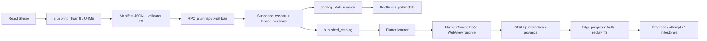

# Bàn giao dự án Mở Học

> Bản cập nhật sau đợt bài mẫu 6 checkpoint, JSON cho AI và đồng bộ Supabase: đọc [PROJECT_HANDOVER_ENGINE_CHECKPOINTS.md](PROJECT_HANDOVER_ENGINE_CHECKPOINTS.md). Số liệu bên dưới phản ánh trạng thái trước đợt đó.

> Cập nhật: 13/11/2026, múi giờ Asia/Saigon. Phạm vi: toàn bộ workspace, tập trung sản phẩm trong `learning-platform/`.
> Đây là bản tổng hợp mã nguồn, cấu hình và bằng chứng hiện có; không phải tuyên bố hệ thống đã đủ điều kiện phát hành production.
> Các kiểm tra chạy lại trong lượt lập tài liệu được tách khỏi kết quả lịch sử. Không kiểm kê lại database live hoặc triển khai thay đổi backend trong lượt này.

## 1. Tóm tắt cho thành viên mới

Mở Học là nền tảng học Toán bằng thao tác, gồm React web cho quản trị/soạn bài và học trên web, Flutter cho học sinh trên mobile, Supabase cho tài khoản, nội dung, phiên bản, tiến độ và hoạt động học.

Luồng chính đã có: tác giả chọn khuôn → nhập dữ kiện → dựng manifest → preview → lưu nháp/xuất bản → mobile tải catalog → học qua checkpoint → gửi nhật ký thao tác để server đánh giá lại → lưu tiến độ.

Hiện trạng thực tế:

- Có 12 dạng bài cơ bản, adapter toán dùng chung, bộ Toán 9 gồm 10 chủ đề/56 checkpoint và 13 loại tương tác U-IME với 15 khuôn.
- Có backend thật trên Supabase; repository có 9 migration. Báo cáo gần nhất ghi cả 9 đã khớp local/remote, hai Edge Function đã deploy.
- Có xác thực, phân quyền, xuất bản bất biến, catalog Realtime và lưu phiên mobile trong secure storage.
- Đã có test TypeScript/SQL, Flutter, browser và integration emulator; phạm vi bằng chứng không đồng nghĩa mọi luồng production đã chạy xuyên suốt.
- **Lỗi gần nhất cần ưu tiên:** mở bài chọn bi trên Android hiện được tiêu đề/đề bài nhưng phần tương tác không hiện, sau đó Android báo “Mở Học isn't responding”. Restart app về Home và tải catalog. Chưa xác định nguyên nhân, chưa xác nhận sửa xong.
- Chưa hoàn tất: nghiệm thu thiết bị thật/iOS, luồng U-IME hosted xuyên suốt tới Edge progress, hosting web production, ký app phát hành, AI provider và kiểm duyệt nội dung đầy đủ.

Việc đầu tiên cho nhóm: chạy được môi trường, chốt baseline kiểm thử, tái hiện lỗi Android, rồi hoàn tất một luồng học thật trước khi mở rộng tính năng.

## 2. Phạm vi và nguyên tắc sản phẩm

- Đối tượng mục tiêu: Toán lớp 6–9; giao diện tiếng Việt, mobile ưu tiên màn hình dọc.
- Một bài học có một scene liên tục và nhiều checkpoint. Checkpoint đổi hướng dẫn, mục tiêu, tương tác được phép và trạng thái; tránh dựng lại toàn bộ engine mỗi bước.
- Bài học là dữ liệu khai báo JSON; nội dung không được chứa mã JS thực thi tùy ý.
- Runtime phát sinh sự kiện và metrics; điều kiện hoàn thành dùng contract chung, không tin một cờ “đã đúng” do client gửi lên.
- Các lựa chọn/ghép mảnh của Toán 9 đã tồn tại trong implementation. Cần tiếp tục rà soát sư phạm để trải nghiệm không dừng ở chọn đáp án theo khuôn.
- Chưa được coi là bao phủ toàn bộ chương trình, mô phỏng vật lý tổng quát, giải đại số ký hiệu hay công cụ dựng mọi bài toán từ văn bản.
- `rea-main/` là công cụ reverse engineering riêng, không phải backend của Mở Học. Giữ nguyên khi làm nền tảng học.

## 3. Bản đồ repository

Các đường dẫn dưới đây tính từ thư mục chứa tài liệu này.

```text
PROJECT_HANDOVER.md                 Tài liệu bàn giao hiện hành
GEMINI.md, .agents/skills/           Hướng dẫn làm việc của workspace
task.md                            Nhật ký công việc nhiều giai đoạn
goal.md                            Ghi chú mục tiêu ban đầu
docs/architecture/                 Thiết kế, audit, database, báo cáo deploy
docs/qa/                           Báo cáo, kết quả test và ảnh bằng chứng
.github/workflows/learning-platform.yml
learning-platform/
  src/                             React CMS, web learner và WebView runtime
  packages/lesson-contract/         Types, validation, capabilities, criteria
  packages/lesson-authoring/        Khuôn bài, blueprint, planner, Toán 9, U-IME
  packages/lesson-runtime/          Session, metrics, replay và evaluation TS
  packages/local-api/               API demo do Vite phục vụ, chỉ phát triển
  contracts/                       Schema JSON và fixtures chuẩn
  apps/mobile/lib/                 Flutter app, repository, domain, renderer
  apps/mobile/test/                Unit/widget tests
  apps/mobile/integration_test/    Kiểm thử thiết bị và fixtures test-only
  apps/mobile/assets/runtime/      Runtime web đã bundle để nhúng WebView
  apps/mobile/assets/contracts/    Schema được đóng gói
  supabase/migrations/             Lịch sử schema và validator SQL
  supabase/functions/              Nguồn và bundle Edge Functions
  scripts/                         Generator, bundle, hosted smoke scripts
  tests/                           Vitest/SQL và Playwright E2E
  .env.example                     Mẫu biến môi trường web
  .env.local, .local/               Cấu hình máy/logs, được gitignore
  task-math9.md                     Bổ sung tiến độ Toán 9/U-IME
rea-main/                          Công cụ khác, không nằm trong app học
```

Thư mục `dist/`, `node_modules/`, `apps/mobile/build/`, `.dart_tool/` là đầu ra/phụ thuộc. Không coi chúng là nguồn để chỉnh tính năng.

## 4. Kiến trúc và luồng dữ liệu



### 4.1 Soạn và xuất bản

1. `BlueprintStudio.tsx` cho chọn dạng, nhập dữ kiện, nạp JSON và dựng bài. `Math9Studio.tsx` được nhúng trong cùng workspace cho Toán 9/U-IME.
2. `lesson-authoring` tính đáp án, tạo checkpoint và chọn capabilities phù hợp.
3. `lesson-contract` kiểm tra schema và ngữ nghĩa: ID, thứ tự, đối tượng, bounds, loại engine, mục tiêu có thể đạt.
4. Preview chạy runtime thật trên web nhưng không lưu tiến độ học sinh.
5. `src/store.ts` gọi `save_lesson_draft`, `publish_lesson`, `unpublish_lesson`.
6. Bản xuất bản là phiên bản bất biến; sửa nội dung phải tạo version mới. Lưu nháp không đưa bài vào catalog.

“Xuất sang mobile” hiện chủ yếu là xuất bản manifest lên Supabase để app tải; không phải tạo một APK riêng cho từng bài. Chỉ khi thay renderer hoặc contract mới cần cập nhật bundle/app/backend tương ứng.

### 4.2 Học và lưu tiến độ

- Web: `Player.tsx` + `LessonSession` TS.
- Flutter: `player.dart` + `domain.dart`; renderer native cho toán cơ bản/tam giác, WebView cho khối hộp và các bài có U-IME.
- `progress` lấy manifest được phép truy cập, replay nhật ký phía server rồi commit progress bằng quyền server.
- Tiến độ có lesson ID, version, revision và attempt identity; không được gộp hai phiên bản nội dung thành một tiến độ.
- Flutter lưu cache/hoạt động theo tài khoản; `activity_sync.dart` có outbox. Retry không được cộng trùng thời gian.
- Hoạt động chia ngày theo timezone; thời lượng học là telemetry thiết bị, không phải chứng nhận chống gian lận.

### 4.3 Catalog cập nhật

- `catalog_state` phát revision thay vì phát draft hay manifest tác giả.
- `catalog_sync.dart` nghe Realtime, bắt kịp sau reconnect/resume và poll dự phòng 30 giây.
- Khi mạng lỗi giữ danh sách cũ; logout/đổi tài khoản hủy subscription cũ.
- Luồng Realtime native đã có acceptance lịch sử; acceptance đó chạy trước renderer Toán 9/U-IME mới.

## 5. Công nghệ và môi trường

| Thành phần | Cấu hình đọc từ repo / máy hiện tại |
|---|---|
| React / React DOM | 19.3.1 |
| TypeScript / Vite | 7.0.2 / 8.3.8 |
| Three.js | 0.187.0 |
| supabase-js | 2.119.0 |
| Validation | Ajv 8.20.0 + kiểm tra ngữ nghĩa TS/Dart/SQL |
| Tests web/SQL | Vitest 5.1.0, PGlite 0.5.16, Playwright 1.65.0 |
| Node trên máy bàn giao | 24.7.0; CI dùng Node 24 |
| Flutter trên máy bàn giao | 3.47.7 stable, Dart 3.13.5 |
| Dart yêu cầu trong pubspec | `^3.13.3` |
| Flutter CI | 3.47.4, cần theo dõi chênh lệch với máy phát triển |
| Mobile dependencies chính | webview_flutter, http, shared_preferences, flutter_secure_storage 11.2.0, realtime_client 2.13.2 |
| Android package | `vn.mohoc.mo_hoc` |
| Emulator đang dùng | AVD `Pixel_9_Pro`, thường là `emulator-5554` |

Android Studio cần Flutter/Dart plugin, Android SDK/emulator và JDK tương thích với Gradle của project. Dùng `flutter doctor -v` để kiểm tra máy mới; không suy ra mọi máy có SDK giống máy bàn giao. Các nền tảng Flutter được scaffold không đồng nghĩa đã kiểm thử phát hành.

## 6. Chức năng theo khu vực

| Khu vực | Đã có | Giới hạn / cần tiếp tục |
|---|---|---|
| Auth web/mobile | Đăng ký, đăng nhập, xác minh email, gửi lại xác minh, logout | Kiểm thử email thật, khôi phục mật khẩu và UX vòng đời account cần rà soát riêng |
| Phiên mobile | Secure storage, khôi phục phiên, refresh token, logout local | Test token hết hạn/thu hồi/mất mạng và đổi account trên thiết bị thật |
| Quản trị | Tổng quan, thư viện, lọc/sort, Studio, công cụ tương tác, user/role, settings | Rà toàn bộ role author/admin và trải nghiệm lỗi khi không đủ quyền |
| Nội dung | Nháp, preview, publish/unpublish, history/version, assignment | Hoàn thiện quy trình duyệt, kho chương trình và giao bài theo nhu cầu nhóm |
| Studio cơ bản | Form thân thiện, JSON, dữ kiện, chọn engine, tinh chỉnh checkpoint | Chỉ nhận các dạng/bounds đã hỗ trợ |
| Toán 9 | 10 chủ đề, 56 checkpoint, sửa câu hỏi/mảnh ghép | Chưa chứng nhận đủ chương trình; Unicode toán, chưa typesetting LaTeX tổng quát |
| U-IME | SVG an toàn, hotspots, JSON engine, mixed checkpoints, thẻ/ô ghép, 3D | Device gestures và hosted progress xuyên suốt còn thiếu acceptance |
| Mobile shell | Home, Bài học, Hồ sơ, tên bài thực, tiếp tục học | Lỗi ANR gần nhất, loading/error và độ dài hướng dẫn cần ưu tiên |
| Hoạt động | Thời gian học, heatmap/timeline, milestones, đồng bộ backend | Audit độ đúng khi offline, nhiều thiết bị, qua ngày/timezone |
| AI | Planner, template mode, endpoint provider phía server | Chưa cấu hình/đánh giá provider thật; gợi ý từ khóa UI không phải AI hiểu đề tự do |
| Curriculum | Tables courses/modules/enrollments và code liên quan | Không có nghĩa đã hoàn chỉnh UI/đường học toàn chương trình |

### 6.1 Các engine cơ bản

| Nội dung | Engine |
|---|---|
| Trục số | `number_line_2d` |
| Phân số | `fraction_bar_2d` |
| Phương trình bậc nhất/cân | `algebra_balance_2d` |
| Parabol | `function_plot_2d` |
| Tam giác/góc | `geometry_2d` |
| Khối hộp/thể tích | `geometry_3d_web` |
| Phần trăm | `percentage_2d` |
| Tỉ lệ | `ratio_2d` |
| Tọa độ | `coordinate_2d` |
| Diện tích/chữ nhật | `area_2d` |
| Pythagore | `pythagorean_2d` |
| Đường thẳng | `linear_plot_2d` |

`math_explorer_2d` là adapter chung và cũng dùng cho recognition. Không cộng tên adapter vào số dạng bài cơ bản để tuyên bố thêm nội dung.

### 6.2 U-IME: 13 loại, 15 khuôn

`TOKEN_CLASSIFIER`, `TAP_COEFFICIENT`, `NUMBER_LINE_SELECTOR`, `INEQUALITY_SIGN_SWITCH`, `FORMULA_SNAP_BUILDER`, `PARABOLA_SLIDER`, `DELTA_STATE_TOGGLE`, `TRIANGLE_HOTSPOT_TAP`, `GEOMETRIC_HOTSPOT_FINDER`, `ANGLE_MEASURE_TAP`, `3D_SOLID_INSPECTOR`, `CHART_BAR_TAP`, `EVENT_CARD_BUCKET`.

Inspector có ba biến thể nón/trụ/cầu nên tổng khuôn là 15. Đây là loại tương tác trong cấu hình recognition, không phải 13 top-level engine IDs mới. Bộ khuôn nằm ở `packages/lesson-authoring/uime-bank.ts`.

## 7. Contract, renderer và điểm mở rộng

- `contracts/problem.schema.json`: đầu vào bài toán cơ bản; `contracts/lesson.schema.json`: manifest runtime.
- Manifest hiện có `schemaVersion: 1.0.0`, locale `vi-VN`, grade 6–9, scene logic 360×360, engine/capabilities, checkpoints và completion.
- `contracts/fixtures/`, `evaluation-vectors.json`, `math-scenarios.json`, `math9-recognition.json`, `uime-fixtures.json` là dữ liệu chuẩn cho kiểm thử/tạo khuôn. Không tự seed vào catalog học sinh.
- `packages/lesson-runtime/index.ts`, `uime.ts`, `extra-models.ts` phải đồng bộ với Dart `domain.dart`, `uime.dart`, `extra_models.dart`.
- `src/Scene2D.tsx`, `MathExplorer.tsx`, `ExtraMathExplorer.tsx`, `RecognitionScene.tsx`, `UimeScene.tsx`, `UimeSolid.tsx`, `Scene3D.tsx` là các renderer web chính.
- Mobile native: `scenes.dart`, `math_scene.dart`, `extra_math_scene.dart`, `recognition_scene.dart`.
- WebView: `SolidView` trong `scenes.dart` ↔ `src/mobile-runtime.tsx`, dùng `LessonChannel` và `window.lessonBridge`.
- Bridge có protocol/session/request ID, READY/INIT/ACK, chuyển checkpoint, reset/pause/resume, chống lặp và retry. Cần xem cả hai phía khi lỗi màn hình trống hoặc timeout.
- Nhập SVG qua `svg-import.ts` loại bỏ thành phần thực thi/tham chiếu ngoài, hiển thị bằng ảnh. Không thay bằng chèn HTML/SVG tùy ý.

Khi thêm engine: bổ sung contract/capability → template/đáp án → validator → TS metrics/replay → Dart tương đương → renderer web/mobile → fixtures/tests → validator SQL và Edge bundle → migration mới nếu cần → acceptance thật.

## 8. Supabase và dữ liệu

### 8.1 Môi trường đã cấu hình

- Project ref: `sbzpmrgsqznaydllqmbm`.
- Endpoint: `https://sbzpmrgsqznaydllqmbm.supabase.co`.
- Dashboard: <https://supabase.com/dashboard/project/sbzpmrgsqznaydllqmbm>.
- Báo cáo triển khai ghi region Sydney `ap-southeast-2`.
- Web ở máy phát triển dùng `.env.local`; Flutter dùng `.local/supabase.mobile.json`. Cả hai không được commit.
- Thành viên mới cần được chủ dự án mời vào Supabase/Git phù hợp. Không sao chép phiên đăng nhập hoặc mật khẩu của người bàn giao. Tài khoản admin có sẵn, không có mật khẩu mặc định.
- Auth có email confirmation. Báo cáo ghi redirect localhost/127.0.0.1 cổng 5173; khi host web phải cấu hình domain thật và kiểm tra lại.
- Những thông tin remote trên là bằng chứng trước đó, chưa được truy vấn live lại trong lần viết tài liệu này.

### 8.2 Các nhóm bảng (18 bảng public theo migration)

| Nhóm | Bảng | Vai trò |
|---|---|---|
| Account | `profiles`, `user_roles` | Hồ sơ và vai trò admin/author/student |
| Nội dung | `lessons`, `lesson_versions`, `lesson_assignments` | Nháp, version bất biến, giao bài |
| Học tập | `lesson_progress`, `checkpoint_attempts` | Snapshot/revision và kết quả |
| Quản trị | `audit_logs`, `engine_registry`, `authoring_jobs` | Audit, khả năng engine, job soạn bài |
| Chương trình | `courses`, `modules`, `module_lessons`, `enrollments` | Cấu trúc khóa học và ghi danh |
| Dịch vụ dữ liệu | `engine_requests`, `study_sessions`, `learning_milestones` | Yêu cầu dạng mới, hoạt động, mốc hoàn thành |
| Catalog | `catalog_state` | Revision cho Realtime |

Cấu hình bootstrap admin và helpers đặc quyền ở schema `lesson_private`. RLS, grants và trigger là thành phần bắt buộc; không sửa bằng cách cho client toàn quyền.

### 8.3 API/RPC quan trọng

`save_lesson_draft`, `publish_lesson`, `unpublish_lesson`, `published_catalog`, `get_published_manifest`, `set_user_role`, `record_study_session`, `my_study_activity`, `commit_lesson_progress`.

`commit_lesson_progress` thuộc luồng tin cậy phía server, không phải API để client tự ghi snapshot đã hoàn thành. Đọc SQL trước khi thay quyền hoặc payload.

### 8.4 Edge Functions

| Function | Chức năng | Nguồn chỉnh sửa |
|---|---|---|
| `progress` | Xác minh Auth, lấy version được phép, replay events, commit idempotent | `supabase/functions/progress/main.ts` |
| `generate` | Xác minh author/admin, quota/job, template/provider, kết quả cần review | `supabase/functions/generate/main.ts` |

`index.ts` được sinh bằng `npm run bundle:edge`. `verify_jwt=false` ở gateway đi kèm kiểm tra bearer qua Auth bên trong function; không xóa kiểm tra đó. Service-role chỉ dùng phía server. Provider tùy chọn dùng `LESSON_AI_ENDPOINT` và `LESSON_AI_KEY` qua secrets server, không qua biến `VITE_*`.

### 8.5 Lịch sử migration

| Timestamp | Nội dung |
|---|---|
| 20261112171824 | lesson_platform |
| 20261112171827 | contract_validation |
| 20261112171829 | trusted_progress |
| 20261112171831 | curriculum_and_roles |
| 20261112171834 | production_data_services |
| 20261112172024 | policy_and_index_hardening |
| 20261112182103 | live_published_catalog |
| 20261113011033 | math9_recognition_contract |
| 20261113013509 | uime_all_engines |

Không sửa lịch sử đã apply. Tạo migration mới, kiểm tra trên môi trường thử, backup và xác minh đích trước khi apply remote. `supabase/generated/` là SQL generator đầu ra, không thay thế migration. Không reset database thật để “làm sạch” môi trường.

## 9. Hướng dẫn chạy trên máy mới

### 9.1 Chuẩn bị cấu hình

Cài Node 24, Flutter tương thích Dart `^3.13.3`, Android Studio/SDK; kiểm tra `node --version`, `flutter doctor -v`, `flutter devices`.

Từ repository root:

```powershell
cd learning-platform
npm ci
```

Tạo `.env.local` từ `.env.example` **chỉ nếu chưa tồn tại**, điền:

```dotenv
VITE_SUPABASE_URL=https://sbzpmrgsqznaydllqmbm.supabase.co
VITE_SUPABASE_PUBLISHABLE_KEY=<publishable-key-do-chu-du-an-cung-cap>
VITE_ENABLE_LOCAL_DEMO=false
```

Tạo `.local/supabase.mobile.json` trên máy mới:

```json
{
  "SUPABASE_URL": "https://sbzpmrgsqznaydllqmbm.supabase.co",
  "SUPABASE_PUBLISHABLE_KEY": "<publishable-key-do-chu-du-an-cung-cap>"
}
```

URL/publishable key là cấu hình client; vẫn không đưa secret/service-role/AI key vào app. File Flutter là cấu hình lúc build: đổi nội dung phải chạy/build lại app.

### 9.2 Web

Từ `learning-platform/`:

```powershell
npm run dev
```

- Learner: <http://127.0.0.1:5173/>.
- Admin: <http://127.0.0.1:5173/admin>.
- Studio: <http://127.0.0.1:5173/admin/studio>.
- Thư viện: <http://127.0.0.1:5173/admin/lessons>.

### 9.3 Emulator và Flutter

Mở AVD bằng Android Studio Device Manager; hoặc PowerShell trên máy Windows có SDK tại vị trí mặc định:

```powershell
& "$env:LOCALAPPDATA/Android/Sdk/emulator/emulator.exe" -list-avds
& "$env:LOCALAPPDATA/Android/Sdk/emulator/emulator.exe" -avd Pixel_9_Pro
adb devices
```

Tên AVD/đường dẫn SDK trên máy khác có thể khác. Nếu ADB báo `unauthorized`, người dùng tự chấp nhận USB debugging trong emulator. Chờ trạng thái `device`.

Trong Terminal Android Studio, từ repository root:

```powershell
cd learning-platform/apps/mobile
flutter pub get
flutter run -d emulator-5554 --dart-define-from-file=../../.local/supabase.mobile.json
```

Máy bàn giao có root `D:\3.FPT\PRM\final project`; nếu Terminal đang ở nơi khác, `cd` tới root trước. Nhấn `r` hot reload, `R` hot restart, `q` dừng phiên Flutter. Không dùng hot reload để thay dart-define hoặc assets đã bundle.

Nếu app đã cài và chỉ cần mở:

```powershell
adb -s emulator-5554 shell am start -n vn.mohoc.mo_hoc/.MainActivity
```

Build APK debug:

```powershell
flutter build apk --debug --dart-define-from-file=../../.local/supabase.mobile.json
adb -s emulator-5554 install -r build/app/outputs/flutter-apk/app-debug.apk
```

`install -r` cập nhật app, không phải xác nhận tương tác đã hoạt động. Cần mở và học thử sau cài.

### 9.4 API demo local

API này chỉ dành phát triển, không có phân quyền production. Không bật trên server public. Web ưu tiên Supabase nếu URL/key vẫn có; muốn chạy demo phải dùng cấu hình riêng không có URL/key Supabase và bật `VITE_ENABLE_LOCAL_DEMO=true` trước khi khởi động Vite.

Workspace demo lưu ở `.local/workspace.json`, bắt đầu rỗng; không tự seed fixture. Flutter có `LOCAL_API_URL` mặc định `http://10.0.2.2:5173/api` khi không có cấu hình Supabase. Đây không phải chế độ offline production.

## 10. Quy trình build và đồng bộ đầu ra

Từ `learning-platform/`:

```powershell
npm run contracts:generate
npx tsx scripts/export-math9.ts
npm run typecheck
npm test
npm run build
npm run bundle:mobile
npm run bundle:edge
```

- `contracts:generate` sinh schema/blueprints và SQL contract preview; hiện **không** gọi `export-math9.ts`, nên phải chạy riêng khi sửa Toán 9/U-IME bank.
- `bundle:mobile` build JS/CSS runtime vào mobile assets, copy schema và sinh `integration_test/fixtures.dart`. Không chỉ chạy Flutter sau khi sửa runtime web mà bỏ bước này.
- `bundle:edge` cập nhật bundle `index.ts` từ nguồn `main.ts` cùng shared runtime. Thay bundle trên disk không tự deploy remote.
- Sau sinh phải xem diff và chạy test. Generator có thể ghi đè schema/fixture: sửa nguồn generator và dữ liệu nguồn phù hợp, tránh sửa đầu ra rồi bị mất.
- Khi validator thay đổi, giữ tương thích với manifest/version đang được người dùng học; thiết kế migration thay vì làm version cũ không đọc được.

## 11. Kiểm thử và mức tin cậy

### 11.1 Chạy kiểm tra

Từ `learning-platform/`: `npm run typecheck`, `npm test`, `npm run build`, `npm run test:e2e`.

Playwright dùng Chrome channel, port 5174 (hoặc `PLAYWRIGHT_PORT`), một worker, API test riêng và ghi đè URL/key Supabase thành rỗng. Không trỏ E2E local sang dữ liệu thật. Cài browser test phù hợp nếu máy chưa có Chrome/Playwright browser cần thiết.

Từ `apps/mobile/`: `flutter analyze`, `flutter test`.

Ví dụ integration (cần emulator đã chạy và assets cập nhật):

```powershell
flutter drive --driver=test_driver/integration_test.dart --target=integration_test/uime_engines_test.dart -d emulator-5554
```

Các target khác: `acceptance_test.dart`, `math_flow_test.dart`, `extra_engines_test.dart`, `mobile_shell_test.dart`, `auth_flow_test.dart`, `live_catalog_test.dart`. Đọc yêu cầu/defines của từng target trước khi chạy, đặc biệt các bài test hosted cần account thử và cleanup.

`scripts/supabase-smoke.mjs` và `live-catalog-e2e.mjs` là kiểm thử có tác động backend thật; đọc mã, cấu hình môi trường và phạm vi dữ liệu trước khi chạy. Không coi chúng là lệnh smoke an toàn để chạy mù trên production.

### 11.2 Kiểm tra chạy lại khi viết tài liệu

| Kiểm tra | Kết quả |
|---|---|
| `npm test` | PASS: 7 test files, 81 tests |
| `npm run build` | PASS: TypeScript và Vite build; cảnh báo import resolution cho configLoader native tương lai và chunk JS khoảng 1.30 MB trước gzip |
| `flutter analyze` | PASS: No issues found |
| `flutter test` | PASS: 48 tests |
| Browser/device/hosted E2E | NOT RUN trong lượt viết tài liệu |

### 11.3 Bằng chứng lịch sử đáng đọc

- `docs/qa/uime-verification.md`: 81 TS/PGlite, 48 Flutter tests; 15 khuôn trên browser; emulator WebView đánh giá bridge trong Dart; hosted RPC publish thử trong transaction rollback.
- Test Android U-IME đó dùng điều khiển DOM-dispatched trong runtime, **không chứng minh physical finger gestures cho từng engine**.
- `docs/qa/math9-verification.md`: 10 chủ đề/56 checkpoint, các con số test ở mốc trước U-IME.
- `docs/qa/live-catalog-hosted-results.json`: luồng admin publish → native catalog → open → unpublish trước Toán 9/U-IME.
- `docs/qa/supabase-hosted-smoke.json`: Auth/PostgREST/Edge và isolation ở mốc rollout trước.
- `docs/qa/verification-report.md`: nhật ký tổng hợp, phải đọc phần mới cùng giới hạn.

Không lấy các số test khác thời điểm cộng vào nhau thành một tổng. PASS trên máy/emulator cũ không loại trừ ANR mới. Bằng chứng tách rời publish, renderer và replay chưa thay được một run hosted liên tục.

## 12. Lỗi và rủi ro đang mở

| Ưu tiên | Vấn đề / bằng chứng | Cách tiếp tục và tiêu chí xong |
|---|---|---|
| P0 | Android mở bài chọn bi bị trắng phần tương tác rồi ANR trong phiên gần nhất | Tái hiện từ cold launch; thu logcat/ANR traces, WebView logs; sửa có regression; học xong bài bằng thao tác thật và Edge ghi progress |
| P0 | Chưa có acceptance liên tục hosted → Realtime → U-IME mobile → Edge progress | Một run với admin/student thử riêng, ghi timestamp, version, checkpoint, reload/resume và readback; cleanup đúng dữ liệu thử |
| P1 | Emulator API35/WebView có lịch sử ART/JNI native crash | So sánh emulator khác và Android thật; xem report U-IME; không coi workaround emulator là cách sửa sản phẩm |
| P1 | WebView chưa có fallback giáo dục tương đương cho mọi bài 3D/U-IME | Có loading/timeout/error/retry rõ, không trắng vô hạn; không mất tiến độ; phương án cho thiết bị không hỗ trợ |
| P1 | Security advisor từng còn WARN leaked-password protection disabled | Chủ dự án rà cấu hình Auth, khả năng gói dịch vụ và policy mật khẩu; chạy advisor lại khi phát hành |
| P1 | Chưa host frontend production/chưa ký Android release | Domain HTTPS, redirect Auth, release signing riêng, quản lý secrets, smoke sau deploy |
| P1 | Nội dung chưa được rà chương trình/giáo viên đầy đủ | Ma trận kiến thức và rubric; review câu chữ, đáp án, gợi ý, trường hợp sai; người duyệt xác nhận |
| P2 | Web bundle lớn, import resolution warning từ Vite | Tách lazy-loaded 3D/admin, đo tải thực; sửa import theo config hiện hành và kiểm tra regression |
| P2 | Tài liệu/metadata scaffold và ghi chú cũ không đồng bộ | Sửa README mobile, engine matrix, deployment notes và checklist sau khi chốt trạng thái mới |
| P2 | Workspace có nhiều thay đổi chưa commit | Chia commit theo tính năng, kiểm tra generated files/binary evidence và secrets trước PR |

Về ANR: đã quan sát lỗi thật; chưa có log đủ để kết luận do SVG, JS bridge, Flutter, GPU, JNI hay tải hệ thống. Không ghi một giả thuyết thành nguyên nhân đã xác nhận. Report U-IME trước có nhắc workaround `debug.checkjni`; không tự áp dụng thay cấu hình debug/security để che lỗi acceptance.

## 13. Bài chọn bi ba màu để tái hiện

- Tên trong CMS: **Chọn bi ba màu — Phân loại biến cố**, lớp 9, một checkpoint, `EVENT_CARD_BUCKET`.
- Thùng có 5 đỏ + 3 xanh + 2 vàng; SVG minh họa; sáu thẻ phân loại. Đây là bài phân loại biến cố, chưa phải mô phỏng rút bi ngẫu nhiên nhiều lần.
- Đã thao tác preview web đúng sáu thẻ và mở nút hoàn thành; đã publish, chuyển sang thư viện đọc lại “Đã xuất bản”.
- Android gần nhất đã hiện đề/tên bài nhưng chưa nghiệm thu tương tác; từng hiện hộp thoại app không phản hồi. Sau restart về Home đang tải danh sách.
- Không hard-code ID đoán từ tên; tìm bài trong CMS/database bằng quyền hợp lệ để lấy ID/version thật trước khi debug.

| Thẻ | Nhóm đúng | Xác suất |
|---|---|---|
| Bi đỏ, xanh hoặc vàng | Chắc chắn | 1 |
| Bi màu tím | Không thể | 0 |
| Bi màu đỏ | Ngẫu nhiên | 5/10 |
| Bi màu xanh | Ngẫu nhiên | 3/10 |
| Bi màu vàng | Ngẫu nhiên | 2/10 |
| Bi không phải màu đỏ | Ngẫu nhiên | 5/10 |

Ảnh: `docs/qa/three-color-web-preview.png`, `three-color-published.png`, `three-color-mobile-open.png`. Ảnh cuối đã bị chụp đè qua các lần mở/restart, không coi nó là bản lưu cố định của hộp thoại ANR.

## 14. Kế hoạch hoàn thiện đề xuất

Các giai đoạn dưới đây là thứ tự đề xuất, chưa phải cam kết thời gian hoặc công việc đã hoàn thành.

### Giai đoạn A — Chốt baseline và mở được bài thật

1. Chủ dự án cấp repository/Supabase access cho thành viên, chia sẻ publishable config qua kênh nhóm, mỗi người tự đăng nhập.
2. Chốt toolchain, lockfiles và branch chung; kiểm tra toàn bộ diff trước commit vì workspace có nhiều thay đổi tồn đọng.
3. Chạy TS/build/Flutter baseline, browser E2E; lưu phiên bản tool, commit và kết quả vào QA.
4. Dùng bài chọn bi tái hiện ANR; kiểm tra `player.dart`, `SolidView`, runtime assets, bridge READY/INIT và WebView logs. Đối chiếu emulator khác/điện thoại thật.
5. Sau sửa: chạy cả bài native và WebView, cold start/reopen/background/resume, text scale và màn hình nhỏ. Tiêu chí: không ANR, không trắng, có tương tác và hoàn thành đúng.

### Giai đoạn B — Chứng minh luồng dữ liệu xuyên suốt

1. Chuẩn bị admin/author/student thử với quyền tách biệt, không đưa credentials vào repo.
2. Author tạo bài nhiều checkpoint, preview, lưu nháp; student chưa nhìn thấy nháp.
3. Publish, student tự nhận catalog qua Realtime và mở đúng version.
4. Student thao tác đúng/sai, đóng/mở lại và hoàn thành; xác minh Edge progress, revision, attempts, milestones và thời gian học.
5. Thử unpublish trong khi học, version cũ/resume, republish version mới, offline/reconnect và đổi account.
6. Ghi bằng chứng readback và dọn đúng run thử. Tiêu chí: RLS đúng, không lộ draft/progress user khác, không mất/đếm trùng tiến độ.

### Giai đoạn C — Hoàn thiện nội dung và trải nghiệm

1. Chốt phạm vi nộp/demo (lớp/chủ đề/số bài), không mặc định phải làm toàn bộ 6–9 trong một sprint.
2. Lập ma trận curriculum → mục tiêu → engine → checkpoint → bằng chứng đạt; giáo viên/nhóm nội dung duyệt.
3. Rút ngắn hướng dẫn dài, tách thao tác và phản hồi; thêm hướng dẫn chạm/kéo dễ hiểu, semantics/accessibility.
4. Hoàn thiện luồng tìm bài/lọc/tiếp tục, quản lý khóa học/giao bài nếu thuộc yêu cầu nghiệm thu.
5. Quyết định có thật sự cần AI provider trong bản nộp; nếu có, làm riêng adapter server, quota, timeout, review và đánh giá chất lượng. Không để AI tự sinh executable code hoặc điều kiện chấm không được kiểm soát.

### Giai đoạn D — Đóng gói và triển khai

1. Tách môi trường dev/staging/production hoặc ít nhất dữ liệu/account thử có phạm vi rõ.
2. Chốt frontend hosting, SPA route fallback và Auth redirect HTTPS; deploy từ build đã test.
3. Quản lý Android release keystore ngoài repo, thay debug signing cho release; xác định app icon/name/version và quy trình phân phối.
4. Kiểm tra Auth/RLS/advisors, logging, backup và quy trình rollback; không rollback bằng sửa version đã publish.
5. Nghiệm thu Android thật; nếu iOS trong phạm vi thì build/test trên macOS và thiết bị phù hợp.
6. CI thêm browser E2E, kiểm tra generated artifact drift và release build; môi trường hosted/device chạy riêng với secrets và cleanup kiểm soát.

### Giai đoạn E — Bàn giao cuối kỳ

1. Chốt commit/tag, APK hoặc link phân phối, URL web, hướng dẫn account theo vai trò.
2. Tài liệu ERD/API, kiến trúc, test matrix và known issues khớp đúng bản release.
3. Kịch bản demo: admin tạo → publish → student nhận bài → học → lưu → resume → xem hoạt động.
4. Phân công người vận hành Supabase, quản lý domain/signing và nhận lỗi sau bàn giao.

### Gợi ý phân công

| Vai trò | Phần chịu trách nhiệm | Đầu ra cần bàn giao |
|---|---|---|
| Mobile | ANR, WebView/native, auth/session, offline/resume, device QA | Bản app ổn định, logs, regression và thiết bị đã test |
| Web/Studio | Form/JSON, checkpoint, preview, publish, responsive | Tạo/sửa bài review được, UX lỗi rõ |
| Backend/contract | SQL/RLS/RPC, Edge replay, migrations, telemetry | Contract tương thích, isolation/idempotency và deploy evidence |
| Nội dung/QA | Curriculum, đáp án, rubric, acceptance và demo | Bộ bài đã duyệt, test matrix và biên bản nghiệm thu |

Nhóm ít người có thể kiêm nhiệm nhưng mỗi thay đổi semantics cần người thứ hai đối chiếu TS/Dart/SQL.

## 15. CI, release và tình trạng Git

- Workflow hiện có hai job: `contracts-web` chạy npm typecheck/test/build/mobile bundle/edge bundle; `flutter` chạy pub get/analyze/test.
- Chưa thấy workflow này chạy Playwright, build APK release, emulator hoặc hosted E2E. Không gán nhãn CI đã phủ các bước đó.
- Khi kiểm kê có khoảng 178 dòng thay đổi tracked/untracked từ `git status --porcelain`. Đây là snapshot workspace có nhiều công việc chưa commit; kiểm tra lại số liệu trước khi chia việc.
- Không reset/checkout đè thay đổi của thành viên khác. Tạo branch theo quy ước nhóm; khi dùng Codex mặc định prefix `codex/` nếu không có chỉ dẫn khác.
- Duyệt `.env*`, `.local/`, secrets, signing files và dữ liệu account trước commit. Chỉ commit config mẫu dùng placeholder.
- Android release hiện còn cấu hình dùng debug signing trong Gradle; cần xử lý trước phát hành thật.

## 16. Cách đọc tài liệu và xử lý mâu thuẫn

1. Tài liệu này cho hướng tiếp nhận tổng thể; dùng mã nguồn/migration hiện hành để xác minh chi tiết.
2. `docs/qa/uime-verification.md` mới hơn phần “NOT IMPLEMENTED” U-IME trong `math9-verification.md`; các engine đó đã có implementation, nhưng vẫn còn giới hạn device/hosted acceptance.
3. `supabase-deployment.md` có đoạn đầu 6 migration/17 bảng và ghi chưa lưu refresh token; các mục cập nhật, 9 migration trên disk và `session_store.dart` cho thấy trạng thái đã tiến lên. Không dùng đoạn cũ làm kết luận hiện tại.
4. `engine-capability-matrix.md` còn liệt kê sáu engine ban đầu; đối chiếu registry và danh sách trong tài liệu này.
5. `task.md` là lịch sử nối thêm, có checkbox “chưa làm Supabase” ở mục cũ dù phần sau đã deploy. Có ghi chú encoding cũ trong `task-math9.md`; giữ backup trước khi chuẩn hóa UTF-8.
6. Master spec là mục tiêu/blueprint; thư viện được đề xuất trong spec không đồng nghĩa đã cài (ví dụ Riverpod, router, physics, Rive).
7. README mobile vẫn là scaffold Flutter; dùng hướng dẫn chạy trong tài liệu này trước khi nhóm cập nhật README.

## 17. Điều kiện đề nghị để gọi dự án hoàn thiện

- [ ] Máy thành viên mới chạy được web/mobile từ source và config mẫu, không cần file bí mật của máy tác giả.
- [ ] Toàn bộ kiểm tra bắt buộc PASS trên commit/tag nghiệm thu; cảnh báo và NOT RUN có giải thích.
- [ ] Bài native và U-IME/3D mở ổn định trên Android thật; lỗi ANR chọn bi có regression.
- [ ] Hosted create/publish/catalog/interaction/progress/resume chạy xuyên suốt bằng vai trò thật.
- [ ] RLS/account isolation, version bất biến, offline retry/idempotency được xác minh.
- [ ] Nội dung trong phạm vi đã có người duyệt và đáp án/hints đúng.
- [ ] Có loading/error/retry, accessibility và màn hình nhỏ không tràn.
- [ ] Có URL web, app đã ký đúng cách, backup và hướng dẫn vận hành/rollback.
- [ ] Repo sạch các secret/test credentials; các thay đổi được review và commit.
- [ ] Tài liệu cuối kỳ phản ánh đúng bản release, không gộp prototype thành production.

## 18. Tài liệu nguồn nên mở tiếp

- [Master spec](docs/architecture/BRILLIANT_INTERACTIVE_LEARNING_MASTER_SPEC.md)
- [Audit](docs/architecture/audit.md)
- [Thiết kế database](docs/architecture/supabase-database-plan.md)
- [Báo cáo Supabase](docs/architecture/supabase-deployment.md)
- [QA tổng hợp](docs/qa/verification-report.md)
- [QA U-IME](docs/qa/uime-verification.md)
- [QA Toán 9](docs/qa/math9-verification.md)
- [Checklist Toán 9](learning-platform/task-math9.md)
- [README app](learning-platform/README.md)
- [CI](.github/workflows/learning-platform.yml)
