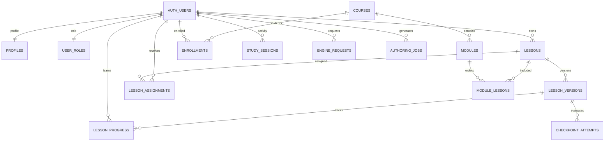

# Thiết kế dữ liệu Supabase — 2026-11-13

> Cập nhật triển khai 2026-11-13: backend thật đã lên Supabase. Trạng thái hiện hành và bằng chứng trong [supabase-deployment.md](supabase-deployment.md); nội dung dưới đây ghi lại kế hoạch ban đầu.

## Phạm vi và hiện trạng đã đọc

Ứng dụng sản phẩm nằm trong `learning-platform/`: React Lesson Studio, Flutter learner,
contract JSON dùng chung, API local và Supabase functions. `rea-main/` là công cụ khác.
Thiết kế này kế thừa bốn migration hiện có, không tạo lại hệ thống từ đầu.
Đây là kế hoạch triển khai; các bảng bổ sung dưới đây chưa được migration hoặc deploy.

Nguồn truy cập dữ liệu đã kiểm tra:

| Chức năng | Mã hiện tại | Nguồn dữ liệu |
|---|---|---|
| CMS và catalog web | `src/store.ts` | Supabase RPC/tables; API local khi bật rõ ràng |
| Catalog Flutter | `apps/mobile/lib/repository.dart` | RPC `published_catalog` sau đăng nhập |
| Draft và publish | `save_lesson_draft`, `publish_lesson` | `lessons`, `lesson_versions` |
| Tiến độ và thao tác | function `progress`, runtime replay | `lesson_progress`, `checkpoint_attempts` |
| Tài khoản và quyền | `src/Users.tsx`, Auth | `auth.users`, `profiles`, `user_roles` |
| Khóa/mô-đun | `src/Curriculum.tsx` | bốn bảng curriculum; màn hình hiện không nằm trong menu |
| Thời gian học, heatmap, timeline | Flutter `activity.dart`, `main.dart` | SharedPreferences, chưa đồng bộ Supabase |
| Đề cần thêm tương tác | `BlueprintStudio.tsx`, `Admin.tsx` | localStorage, chưa đồng bộ Supabase |

API local trước đây tự thêm 12 bài mẫu mỗi khi đọc workspace. Cơ chế này đã bỏ.
Web không còn lấy catalog/draft từ localStorage cũ. Các file bài mẫu sao chép trong
Flutter assets đã xóa; dữ liệu thiết bị kiểm thử nằm riêng trong `integration_test/`.
Canonical fixtures, khuôn dựng scene, schema và registry capabilities là tài nguyên
kiểm thử/cấu hình engine, không được tự chèn thành bài học hoặc tài khoản thật.
Không xóa tiến độ, hoạt động hoặc nội dung do người dùng tự tạo.

## Mô hình quan hệ

## Các bảng đã có trong migration

| Bảng | Khóa và quan hệ chính | Trách nhiệm |
|---|---|---|
| `profiles` | `id uuid PK → auth.users` | Tên hiển thị; bổ sung timezone/locale/settings |
| `user_roles` | `user_id uuid PK → auth.users` | Một vai trò: student, author, admin |
| `lessons` | `id text PK`, `owner_id → auth.users` | Draft JSONB, published_version, updated_at |
| `lesson_versions` | PK `(lesson_id, version)` | Manifest bất biến, hash, người và thời điểm publish |
| `lesson_assignments` | PK `(lesson_id, user_id)` | Giao bài trực tiếp, assigned_by |
| `lesson_progress` | PK `(user_id, lesson_id, version)` | Checkpoint hiện tại, snapshot, completion, revision |
| `checkpoint_attempts` | PK `(user_id, attempt_id)` | Kết quả commit/replay; chưa phải log mọi lần thử sai |
| `courses` | `id uuid PK`, owner_id | Khóa học theo lớp 6–9 |
| `modules` | `id uuid PK`, course_id | Các mô-đun có thứ tự |
| `module_lessons` | PK `(module_id, lesson_id)` | Bài học trong mô-đun, sort_order |
| `enrollments` | PK `(user_id, course_id)` | Ghi danh active/completed |
| `engine_registry` | `engine_type text PK` | Phiên bản runtime, capabilities, bật/tắt engine |
| `authoring_jobs` | `id uuid PK`, owner_id | Input/result JSONB, trạng thái queued/running/review/failed |
| `audit_logs` | `id bigint identity PK` | Actor, action, object_id, created_at |

Giữ lesson ID dạng text để tương thích contract hiện có. Không đổi UUID người dùng
do Supabase Auth cấp. Quan hệ tới một phiên bản phải dùng cả lesson_id và version.
`lessons.(id,published_version)` đã tham chiếu khóa ghép của `lesson_versions`.
Một lesson giữ một scene xuyên checkpoint; không tách scene thành các bản sao theo bước.
Manifest JSONB là bản thực thi chuẩn, relational tables quản lý quyền và vòng đời.

## Bổ sung cần làm

### Hồ sơ và nội dung

- Thêm `profiles.timezone text default 'Asia/Ho_Chi_Minh'`, `locale text default 'vi-VN'`,
  `settings jsonb default '{}'`, `updated_at timestamptz`. Chỉ cho cập nhật cột hồ sơ;
  không lưu role trong settings/user_metadata để cấp quyền.
- Tên profile Flutter hiện lưu trên thiết bị: chuyển sang cập nhật `profiles`.
- Thêm `engine_requests(id uuid PK, owner_id uuid FK, problem text, status text,
  created_at timestamptz, updated_at timestamptz)`; giới hạn problem 1–10000 ký tự,
  status thuộc submitted/reviewing/supported/closed. Owner đọc/tạo yêu cầu của mình;
  admin xử lý trạng thái. Client không tự đặt supported.
- Chủ đề hiện nằm trong manifest.topicIds. Giai đoạn đầu giữ nguyên; khi cần quản lý
  chương trình có `subjects`, `topics`, `lesson_topics` với FK, slug unique và grade.
  Không bổ sung taxonomy rỗng nếu chưa có luồng biên soạn tương ứng.

### Hoạt động học và thống kê

- Thêm `study_sessions(id uuid PK, user_id uuid FK, lesson_id text, version integer,
  device_id uuid, started_at timestamptz, ended_at timestamptz, active_seconds integer,
  revision integer, created_at timestamptz, updated_at timestamptz)`.
- FK `(lesson_id,version)` tới lesson_versions; CHECK revision >= 0,
  ended_at >= started_at, active_seconds >= 0 và không vượt thời lượng session.
- RPC/function nhận ID ổn định và revision, kiểm tra user từ token; gửi lại cùng
  revision/payload không cộng thêm thời gian. Không nhận user_id do client tự khai.
- Thời gian giữa các thiết bị phải hợp nhất khoảng hoạt động trùng trước khi tính
  tổng. Chia khoảng theo ngày ở timezone hồ sơ, kể cả session qua nửa đêm.
  Không cộng trực tiếp các tổng `StudyActivity.days` từ nhiều thiết bị.
- Streak, heatmap, completion và checkpoint milestones được tính từ phiên hoạt động
  hợp lệ và progress đã xác minh. Không để client ghi cột streak/completed_count.
- Nếu cần timeline bền vững, thêm `learning_milestones` với unique
  `(user_id, lesson_id, version, kind, checkpoint_id)`; checkpoint_id có giá trị ổn định
  cho cả completion. Chỉ trusted backend ghi khi replay xác nhận chuyển trạng thái.
- Tổng hợp ban đầu bằng RPC invoker theo auth.uid(); bổ sung daily rollup riêng khi
  EXPLAIN và dữ liệu thực chứng minh cần. Thời gian thiết bị báo lên chỉ là telemetry,
  không dùng làm chứng nhận học hoặc thang điểm chống gian lận.

### Assets — giai đoạn sau

Hiện hình học được vẽ bằng mã, chưa cần bucket để thay thế chúng. Khi thêm ảnh/audio/GLB/Rive,
dùng `lesson_assets(id uuid PK, owner_id uuid FK, bucket_id, object_path unique,
mime_type, byte_size, checksum, created_at)` và `version_assets(lesson_id,version,asset_id)`.
Draft dùng bucket private; đọc qua signed URL khi có quyền. Asset của version published
không ghi đè cùng object_path; dùng path mới/hash nội dung. Storage policies kiểm tra
owner và quyền lesson, không chỉ kiểm tra đã đăng nhập.

## Quyền và API

| Đối tượng | Student | Author | Admin / trusted backend |
|---|---|---|---|
| Hồ sơ | Đọc/sửa chính mình | Như student | Admin đọc danh sách; quyền thay role qua RPC riêng |
| Draft | Không đọc | Đọc/sửa bài sở hữu | Admin quản lý, publish/unpublish |
| Published | Đọc catalog đã xuất bản | Như student | Version bất biến, không update/delete |
| Progress/attempts | Đọc của mình | Đọc của mình | Function replay ghi; không cấp client quyền ghi |
| Sessions/milestones | Đọc của mình | Đọc của mình | Function kiểm tra và ghi/merge |
| Curriculum | Khóa được ghi danh | Khóa sở hữu | Admin quản lý ghi danh |
| Requests/jobs | Dữ liệu của mình khi được phép | Job/yêu cầu của mình | Admin kiểm duyệt |
| Audit/registry | Registry chỉ đọc | Registry chỉ đọc | Audit chỉ admin đọc; registry do quản trị tin cậy sửa |

Chốt cho MVP: mọi tài khoản đăng nhập đọc mọi bài đang xuất bản; assignment là giao bài,
không phải ACL. Đây cũng là hành vi `published_catalog` hiện có. Nếu cần lớp học kín,
phải sửa đồng thời catalog, get_published_manifest và Edge progress theo enrollment/assignment.

RLS bật trên mọi bảng public; GRANT và policy phải đồng bộ. Update cần SELECT policy,
USING và WITH CHECK. Helper definer nằm trong lesson_private, search_path rỗng,
kiểm tra danh tính/quyền và revoke PUBLIC EXECUTE; wrapper public dùng invoker.
Service-role chỉ trong Edge/server. Views mới dùng security_invoker.

## Các điểm phải xử lý trước rollout

1. Trigger tạo profiles/user_roles chỉ áp dụng user mới: backfill user đã tồn tại,
   giữ vai trò hiện có; bootstrap admin qua kênh quản trị tin cậy.
2. Chốt quy tắc gỡ bài: catalog ngừng hiện; người có progress vẫn đọc phiên bản cũ
   theo manifest RPC. Function progress hiện phải được kiểm tra để không chặn việc
   tiếp tục phiên bản cũ trái với quy tắc này.
3. Bổ sung chỉ mục `lesson_assignments(assigned_by)`, audit_logs(actor_id,created_at),
   audit_logs(created_at), checkpoint_attempts(user_id,occurred_at),
   study_sessions(user_id,started_at), engine_requests(owner_id,created_at).
   PK/FK index hiện có giữ lại; không tạo GIN cho toàn manifest khi chưa có truy vấn.
4. Module sort_order cần CHECK >= 0, quy tắc thứ tự trùng và tái sắp xếp transaction.
   Query nested modules/module_lessons phải order tường minh.
5. UI assignLesson dùng upsert nhưng grant hiện chưa có UPDATE assignment:
   chuyển insert + onConflict ignoreDuplicates hoặc RPC giao bài idempotent.
6. Kiểm tra attempt_id tái sử dụng với payload khác: phải reject, không chỉ ON CONFLICT
   DO NOTHING rồi vẫn cập nhật tiến độ. Phân biệt attempt commit với telemetry sai/đúng.
7. Mật khẩu không nằm trong profiles. Mobile Auth cần refresh/session lifecycle;
   HTTP access token trong RAM hiện tại chưa đủ cho đăng nhập lâu dài.
8. Chính sách xóa tài khoản phải xử lý FK và audit; không cascade xóa published versions.
   Không tuyên bố chức năng xóa user đã hoàn thành ở schema hiện tại.

## Trình tự thực hiện và nghiệm thu

1. Chọn Supabase project đích từ cấu hình xác thực. Connector hiện thấy một project,
   nhưng repo chỉ có `.env.example`, chưa đủ bằng chứng chọn đó làm database của app.
   Phiên này không thay đổi remote.
2. Kiểm kê tables, migrations, grants, policies, extensions; backup schema/data;
   đối chiếu tên bảng trước khi chạy bốn bootstrap migration hiện có.
3. Chạy bootstrap trên database phát triển trống; migration bổ sung tạo bằng CLI
   `supabase migration new` theo phiên bản CLI đã kiểm tra, không sửa lịch sử đã apply.
4. Thực hiện nhóm hồ sơ/requests, sau đó sessions/milestones và các sửa lỗi quyền.
   Không import fixture làm dữ liệu production; catalog ban đầu rỗng.
5. Nối React/Flutter với profile/requests/activity RPC; giữ cache tiến độ offline theo
   user/version, không tự biến dữ liệu local chưa xác minh thành completion remote.
6. Deploy progress/generate, cấu hình Auth và client publishable key; tắt API local
   trong bản phát hành. Không đưa service-role/AI secret vào app.
7. Test bằng admin, hai author, hai student và anon: không thấy draft/tiến độ chéo;
   student không tự cấp quyền; author không publish; published immutable; enrollment
   đúng phạm vi; retry idempotent; offline reconnect và đổi timezone không đếm trùng.
8. Chạy Supabase advisors, readback qua PostgREST/Edge và kiểm tra thiết bị trước rollout.
   PGlite kiểm chứng SQL không thay thế kiểm chứng Auth/PostgREST/Storage thật.

Tham khảo: [Supabase RLS](https://supabase.com/docs/guides/database/postgres/row-level-security),
[bảo vệ Data API](https://supabase.com/docs/guides/api/securing-your-api),
[changelog](https://supabase.com/changelog).
